# Grok Bot 完整使用指南（2026 图文版）

> 在线精美版：[https://xianyu110.github.io/grokbot/](https://xianyu110.github.io/grokbot/)

> 更新日期：2026-10-14  
> 适用：想从 0 把 Grok Bot 用到「能定时交作业」的人  
> 依据优先：[官方文档 docs.x.ai/grok-bot](https://docs.x.ai/grok-bot/overview)；资格与价格以 [x.ai/bot](https://x.ai/bot) / App 内账单为准  
> 截图来源：Flavio Copes 实机教程、awesome-grok-bot 公开实录、官方文档页；截图已收录于本仓库 `docs/assets/`

---


---

## 先看结论（30 秒）

**Grok Bot ≠ grok.com 聊天，也 ≠ Grok Build。**  
它是一支跑在**云端电脑**上的 AI 同事：能登录网站、点界面、写文件、定时干活；你合上笔记本，它还在跑。

| 产品 | 一句话 |
|------|--------|
| Grok 聊天 | 问答与生成 |
| Grok Build | 写代码的 CLI / coding agent |
| **Grok Bot** | **有电脑的 AI 同事**：登录、操作、定时、协作 |

**还没开通？** 人民币下单见 [第 3 章 · 怎么订阅与开通](#3-怎么订阅与开通)（购买页：https://wzyp.cn/shop/maynorai/gyx7gn ，Grok Bot 月卡 ￥399）。

**最稳的用法只有一条链：**

```text
窄职责 Bot → 手动跑通一次 → 存成 Skill → Test run → 再开 Routine
```

外发、付款、删数据、改生产：**永远放在审批后面。**  
多 Bot **不是**安全隔离——它们共用一台云电脑的登录与文件。

---

## 目录

1. [10 分钟上手](#1-10-分钟上手)
2. [它是什么、和谁不一样](#2-它是什么和谁不一样)
3. [怎么订阅与开通](#3-怎么订阅与开通)
4. [资格、平台与隐私](#4-资格平台与隐私)
5. [安装与登录](#5-安装与登录)
6. [核心概念](#6-核心概念)
7. [创建 Bot 与写好 Profile](#7-创建-bot-与写好-profile)
8. [怎么下任务](#8-怎么下任务)
9. [云端电脑与本机电脑](#9-云端电脑与本机电脑)
10. [Plugins / 连接器](#10-plugins--连接器)
11. [文件与交付物](#11-文件与交付物)
12. [Skill · Teach · Routine](#12-skill--teach--routine)
13. [审批与安全](#13-审批与安全)
14. [多 Bot、群聊与分享](#14-多-bot群聊与分享)
15. [场景 Prompt 模板](#15-场景-prompt-模板)
16. [界面速查与排错](#16-界面速查与排错)
17. [FAQ](#17-faq)
18. [附录：来源与图床链接](#18-附录来源与图床链接)

---


---

## 1. 10 分钟上手

按这个顺序做，比先读完所有概念更有用。

### Step 1 · 装好并登录

从 [x.ai/bot](https://x.ai/bot) 下载桌面端（macOS / Windows / Linux），用 **Cursor 账号**登录。组织账号走 SSO。

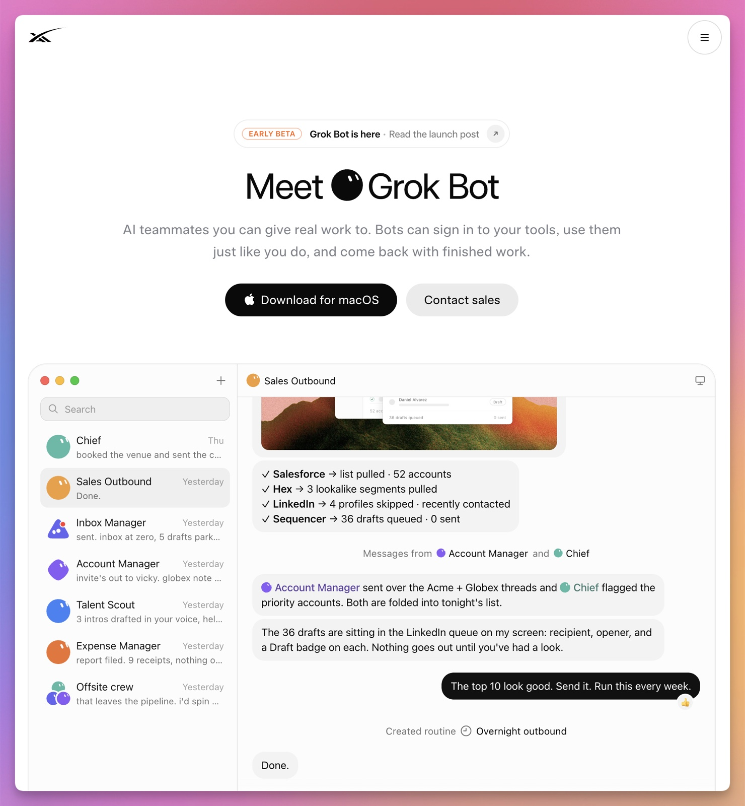

*产品 / 下载入口*

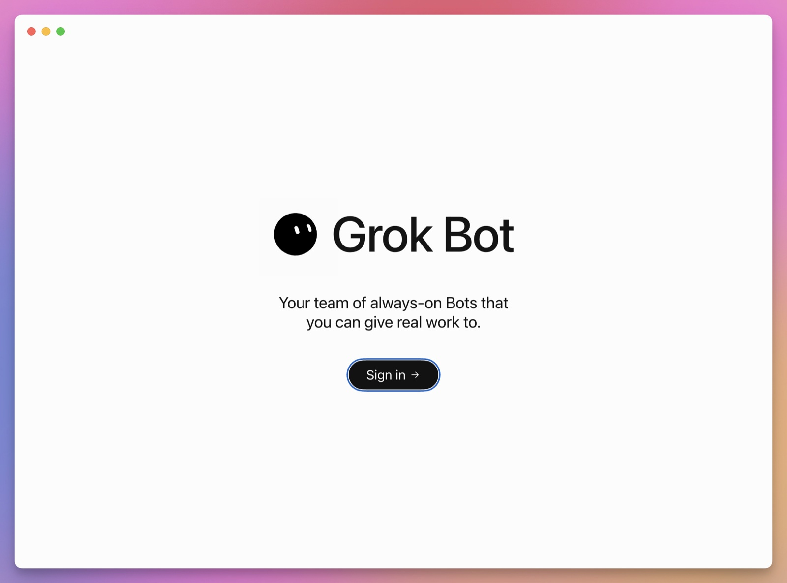

*首屏：Sign in with Cursor*

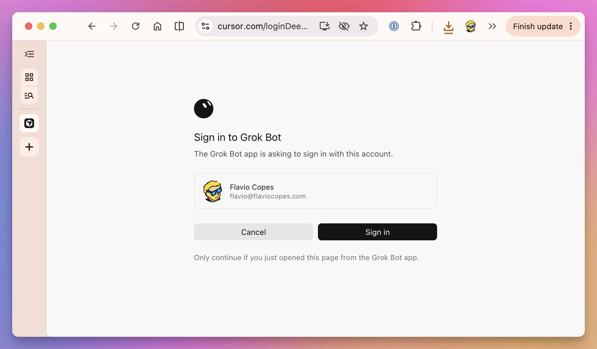

*浏览器里确认授权的那个账号*

macOS：打开 dmg，拖进 Applications。

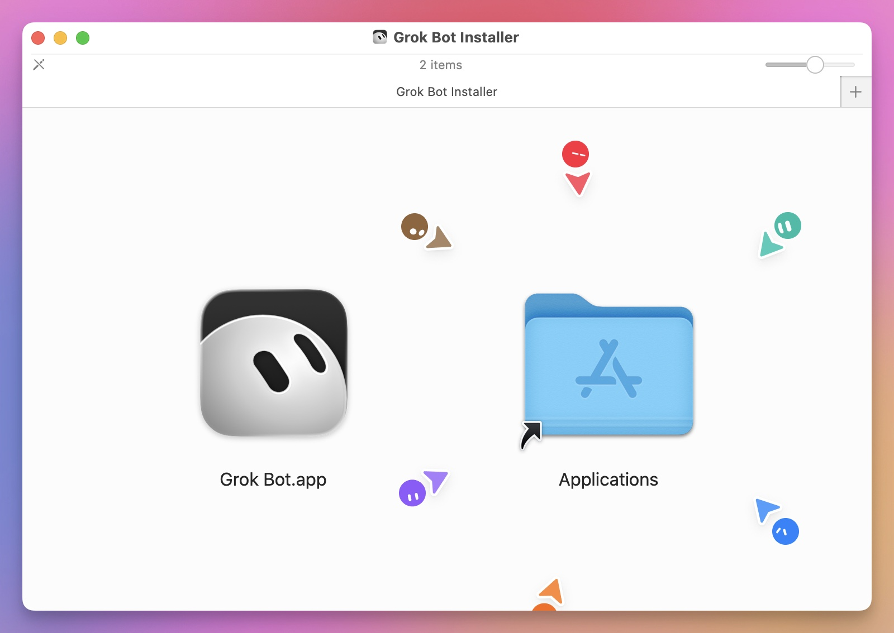

### Step 2 · 只建一个窄职责 Bot

`New` 或 `Cmd/Ctrl+N` → **Create new Bot** → 改 Profile。

- **Name**：方便辨认即可  
- **Title**：一句话岗位  
- **Description**：写清结果、来源、禁止事项、审批边界  


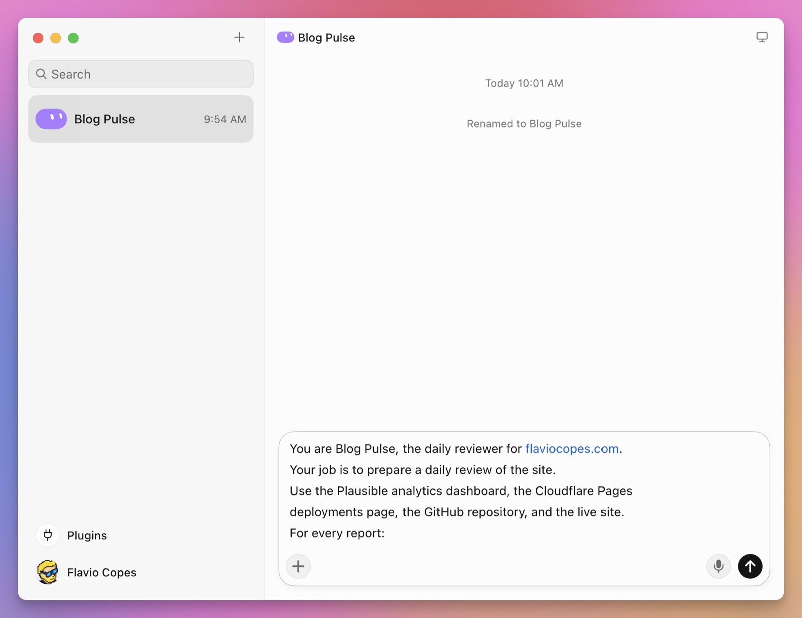

*把「怎么干」写进描述，把「本周干什么」留给消息*

### Step 3 · 用 5 要素下一单真活

1. Outcome：完成什么  
2. Sources：用哪些 App / 网站 / 文件  
3. Constraints：不能做什么  
4. Deliverable：交什么格式  
5. Review point：停在哪等你  

桌面也可用听写（`Cmd/Ctrl+D`）或语音对话。先要**草稿 / 审查清单**，不要一上来就让它外发。

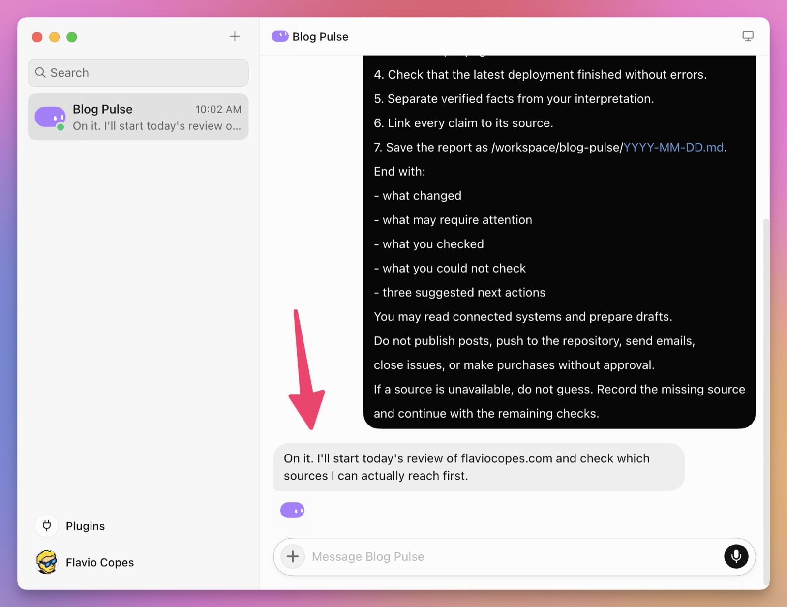

### Step 4 · 需要登录时接管电脑

对话里打开 **Computer**（界面或仍写 Agent Computer）→ Take over → 自己完成密码 / 2FA / CAPTCHA → I'm done 交还。  
**密码不要贴进聊天。**

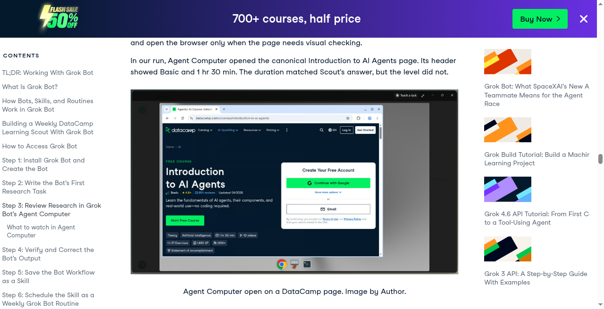

*Agent Computer：看它在点什么、卡在哪*

### Step 5 · 跑通后再 Skill → Routine

手动结果满意 → 让它存 Skill → `/` 再测一次 → 建 Routine → **先 Test run 盯完整场** → 再启用定时。

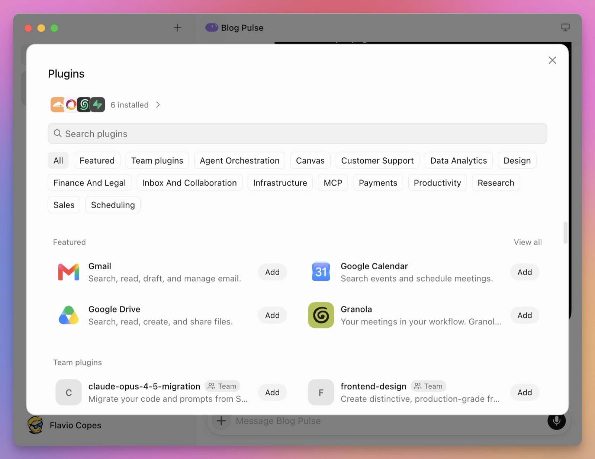

*有插件就优先连插件*

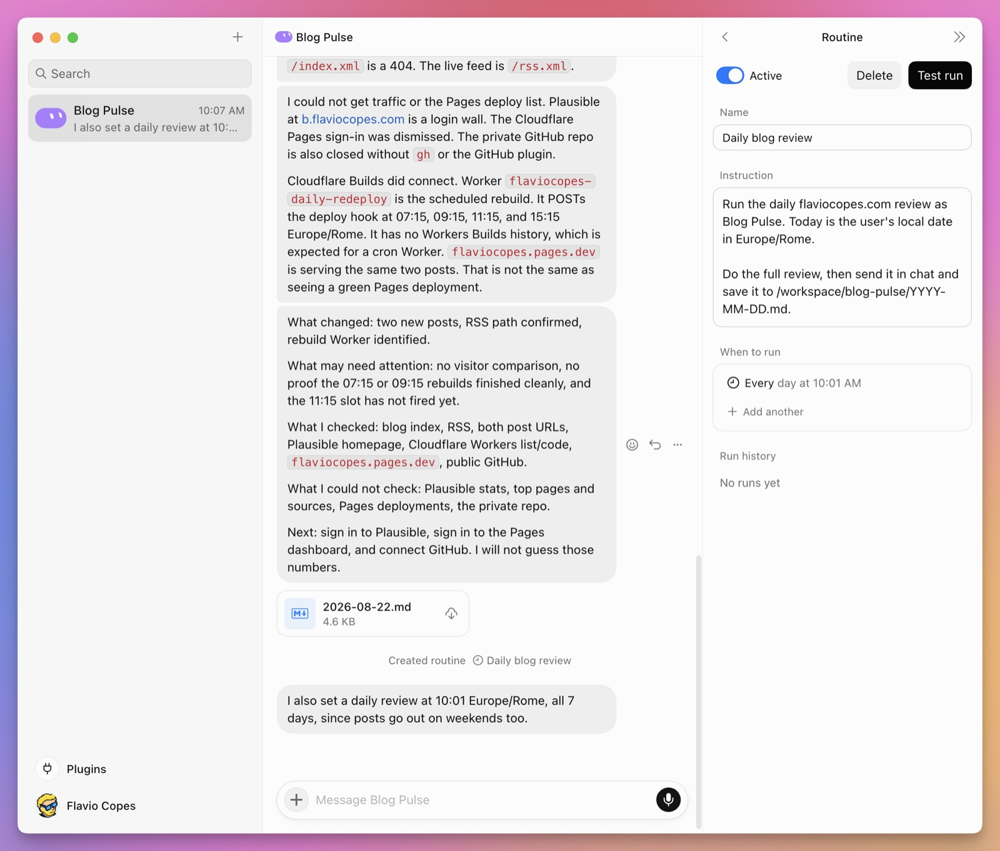

*Routine：日程、指令、Test run、历史*

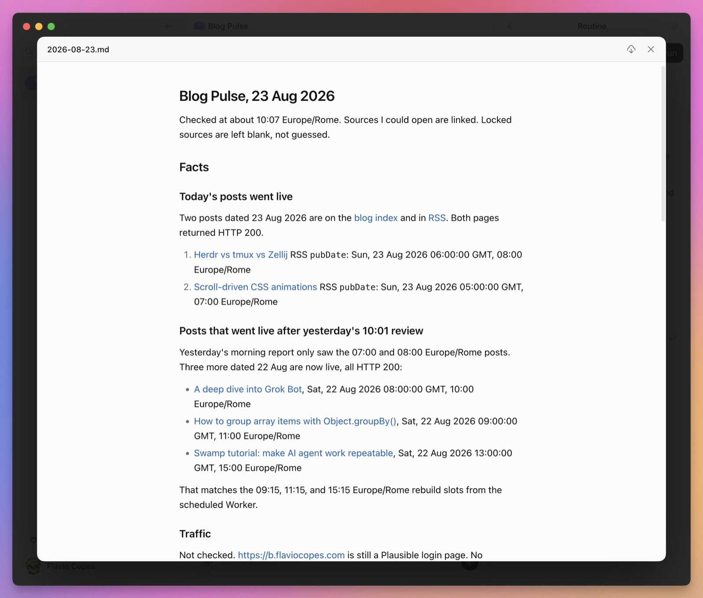

*好交付物：结构化、带源链接、查不到就明说*

---

## 2. 它是什么、和谁不一样

官方定位：Bot 像你一样登录并使用工具；在持久云端电脑上把活干完；只在需要判断或审批时回来找你。

### 和普通聊天助手差在哪

1. **有云端电脑**（浏览器、文件、终端）  
2. **关本机也继续跑**  
3. **命名 Bot 有持久角色与记忆**  
4. **Connector / 浏览器双通道**  
5. **Skill + Routine** 把流程固化  
6. **多 Bot 可并行交接**（仍共用一台电脑）  
7. **可从 X tag `@bot` 派活**（地区有限；结果在 App）

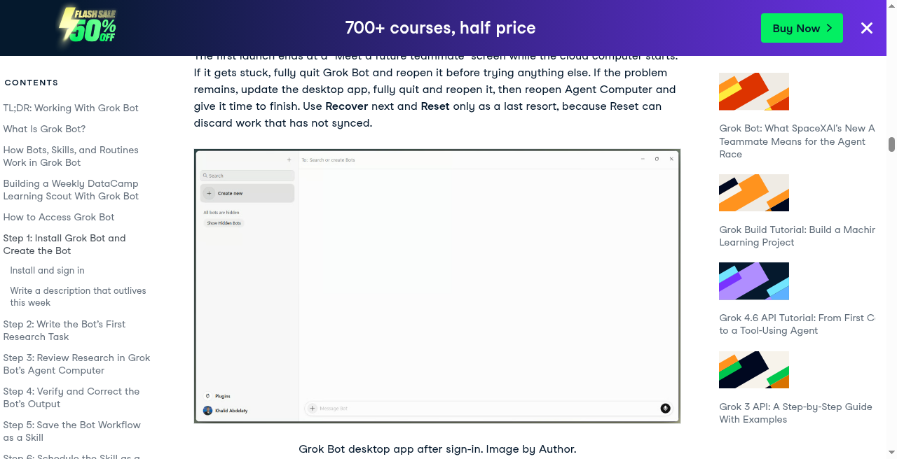

*桌面端对话界面示例（DataCamp 教程截图）*

---

## 3. 怎么订阅与开通

Grok Bot 本身挂在 **Cursor / SuperGrok** 资格上。国内常见有两条路：官方原价订阅，或第三方 CDK 充值通道。下面两条都写清楚，按你的情况选。

### 3.1 官方路径（原厂）

1. 打开 [x.ai/bot](https://x.ai/bot) 或 Cursor / SuperGrok 定价页  
2. 订阅符合资格的套餐（官方：付费个人 Cursor 计划、Cursor Teams；或关联个人 SuperGrok / Plus / Heavy；具体以 [x.ai/bot](https://x.ai/bot) 为准）  
3. 用该 Cursor 账号登录 Grok Bot 桌面 / 手机 App  
4. 在 App 内 **Usage & Billing** 确认已开通、周额度是否到账  

适合：有外卡、能直连官方支付、希望账号完全自有。

### 3.2 推荐购买通道（本教程对接）

人民币下单走本教程对接页（2026-10-14 复核仍可下单）：

**购买链接：<https://wzyp.cn/shop/maynorai/gyx7gn>**

| 项目 | 页面信息（2026-10-14 实测） |
|------|------------------------------|
| 商品名 | **Grok Bot 月卡（399）** |
| 标价 | **￥399.00** |
| 说明 | 可用 Grok Heavy · 稳定使用一个月（以商品页为准） |
| 发货 | 自动发货 |
| 购买 | 游客可买 · 有库存时下单 |
| 查单 | [订单查询](https://momoai.czvip.cn/guest/orders) |

商品页要点（摘录，**以当下页面为准**）：

- 售价 **￥399**，标题 **Grok Bot 月卡（399）**
- 文案提及可用 **Grok Heavy**、稳定使用一个月
- 游客可买，支付后按店铺规则自动发货
- 开通方式与发货内容以商品页 / 客服说明为准；下单前确认账号与售后边界
- 虚拟商品使用后一般不可二次销售；风控与封号以卖家规则为准

> 旧域名 `maynor.czvip.cn` 同路径在 2026-10-14 已无法打开有效商品详情；请用上面的 **momoai** 链接。

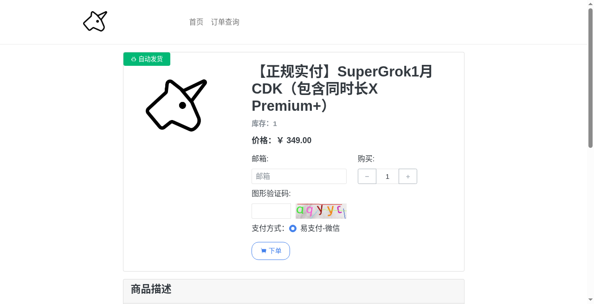

*发卡网购买页示意（截图可能仍显示旧价；下单以页面实时标价为准，当前为 ￥399）*

#### 下单步骤（照着点）

1. 打开 https://wzyp.cn/shop/maynorai/gyx7gn  
2. 确认标题含「Grok Bot」、价格为 **￥399**（若页面改价，以页面为准）  
3. 填写**常用邮箱**（收货 / 查单）  
4. 购买数量一般填 `1`  
5. 按页面提示完成支付  
6. 到邮箱或 [订单查询](https://momoai.czvip.cn/guest/orders) 拿到开通信息  
7. 按卖家说明完成开通后，安装 **Grok Bot** App 并登录  

无货或未发货：先查单，保留支付截图，再联系客服。

#### 开通后接到 Grok Bot

```text
下单成功并拿到开通信息
  → 按商品页说明完成充值或激活
  → 安装 Grok Bot，Sign in with Cursor（同一账号体系）
  → 若来自 SuperGrok：Usage & Billing → Link SuperGrok（界面可能写 Link SuperGrok Heavy）
  → 确认周额度后，回到第 1 章「10 分钟上手」
```

#### 购买前请知悉

- 这是**第三方店铺**，不是 x.ai / Cursor 官方收银台。  
- 请仔细阅读商品页质保、封号与售后边界。  
- 密钥 / 账号信息不发到公开群；只用可收信邮箱下单。  

> 官方独享订阅适合要长期稳定、企业合规的人；要人民币快捷开 **Grok Bot 月卡**，用上面链接，并仔细读商品页说明。


---

## 4. 资格、平台与隐私

> 订阅下单步骤见上一章。本章补充官方名单、平台与隐私门槛。

### 资格（会变，以账号为准）

官方当前表述：

- **每一档付费个人 Cursor 计划**，以及 **Cursor Teams**
- 或把个人 **SuperGrok / SuperGrok Plus / SuperGrok Heavy** 关联到 Cursor 账号

**实操：打开 [x.ai/bot](https://x.ai/bot) 或 App 内 Usage & Billing，以你账号显示为准。**

常见计费形态：每周内含用量 + 符合条件时可按需超额（按实际服务模型计费）；同时有 Cursor 与 SuperGrok 时，官方称用额度更高的一侧。

### 平台

| 平台 | 支持 |
|------|------|
| macOS | Apple silicon / Intel |
| Windows | x64 / Arm64 |
| Linux | x64 / Arm64：`.deb` / `.rpm` / AppImage |
| iPhone | iOS 18+ |
| Android | 9+（以 FAQ 为准） |
| iPad | iPadOS 18+（与 iPhone 同用 iOS App） |

早期文章写「无 Linux 客户端」的，已过时。

### 隐私硬门槛

Grok Bot **需要云端数据存储**。Cursor 若仍是 **Legacy Privacy Mode**，必须先改设置，否则起不来。

---

## 5. 安装与登录

### 下载

[x.ai/bot](https://x.ai/bot) 选对应系统。Linux 在 More downloads。

### 登录

1. Get started / Sign In with Cursor  
2. 浏览器完成认证  
3. 回到 App  

首次引导会问常用工具——**只影响推荐，不会自动连上工具**。云电脑在后台准备。

### 两类更新（别搞混）

| 更新什么 | 入口 |
|----------|------|
| **App** | Settings → Updates → Check for Updates |
| **云电脑** | Settings → Computer → **Update Bot's Computer**（尽量保留持久文件与登录） |
| **不可达时** | 错误态里的 **Recover**（不在 Settings） |
| **最后手段** | **Reset Bot's Computer**（可能丢未同步工作） |

更 App ≠ 重置云电脑。

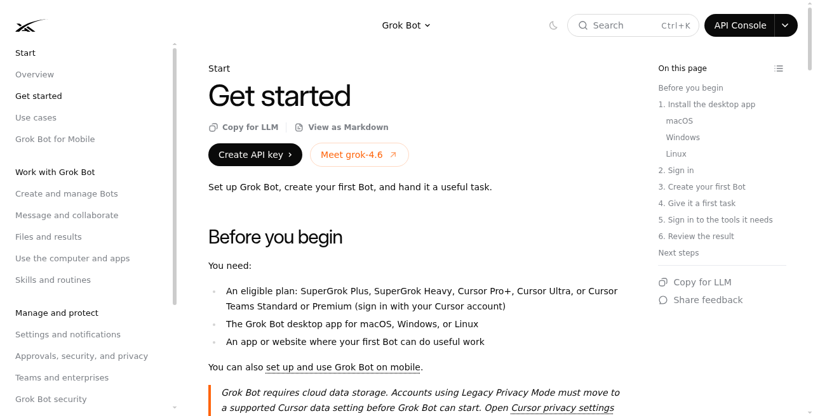

---

## 6. 核心概念

```text
你（审批 / 2FA / 接管）
        │
        ▼
   Grok Bot App ── Bot A / Bot B / 群聊
        │
        ▼
  一台账号级云端电脑
  （/workspace · Cookie · 终端凭证 · Plugins）
        │
   Skill（怎么做） + Routine（何时做）
```

| 名词 | 含义 |
|------|------|
| Bot | 有名字、职责、对话、记忆的持久 Agent |
| Cloud computer | 账号级共享云 VM |
| Plugin / Connector | 结构化接入服务（MCP 等） |
| Skill | 「怎么做」的可复用说明书 |
| Routine | 「何时做」：定时或事件 |
| Auto Review | 自动审查；可 Ask first / Allow automatically |
| Teach a task | 演示一遍生成 Skill 草稿（约 ≤10 分钟） |

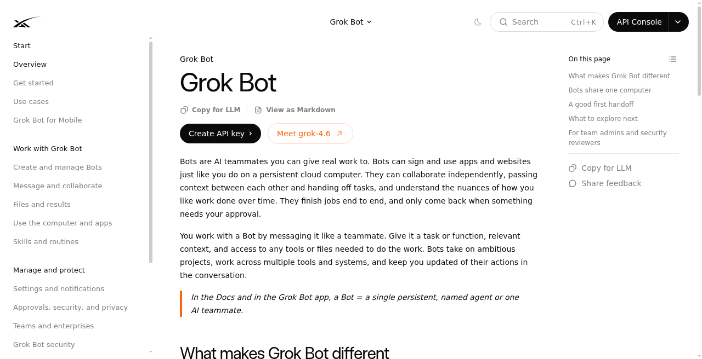

---

## 7. 创建 Bot 与写好 Profile

账号上限约：**50 个 Bot + 群聊合计**。

### 何时新建

工作有独立的目标、工具集、风格、审批边界或周期 → 就该单独一个 Bot。  
「万能助手」通常上下文乱、难复用。

### 创建步骤

1. `New` / `Cmd/Ctrl+N` → Create new Bot  
2. Edit Profile：名字、title、描述、头像  
3. 用一单具体任务开聊  

### Profile vs 消息

| 放进描述（长期） | 放进消息（本单） |
|------------------|------------------|
| 审批边界、输出风格、禁止事项 | 本周目标、名单、附件 |
| 「未经批准绝不外发」 | 「给这 12 个客户写草稿」 |

描述模板：

> Own the weekly account-health review. Pull product usage and support signals, flag churn/expansion evidence, produce a linked watch list. **Never contact a customer or change an account without approval.**

经验：若描述写得像「立刻开工」，Bot 可能一创建就跑——可加一句「把 profile 当 standing context，等单独消息再开始」。

### 固定 / 隐藏 / 复制 / 删除

- **Pin**：钉在侧栏  
- **Hide**：从列表隐藏，**不**暂停 Routine  
- **Duplicate**：复制 profile / Skill / Routine；不复制聊天与记忆  
- **Delete**：删对话与其 Routine；**共享电脑上的文件与登录可能仍在**  

侧栏常见删除：右键 Bot → Delete。

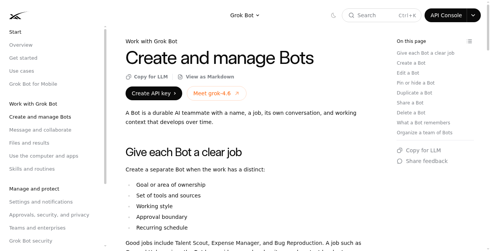

---

## 8. 怎么下任务

### 五要素（官方建议）

Outcome · Sources · Constraints · Deliverable · Review point

### 五分钟练习（无需登录）

> Summarize this document in five bullets. List every date, decision, and open question separately. Cite section for each item. Do not change the source file.

### 需要登录仪表盘时

> Open our analytics dashboard and compare this week's new-user activation with the previous four weeks. Identify the largest step-level change and draft an investigation plan with chart links. Do not change dashboards. Ask me to sign in if needed.

### 六级用法心法

1. 先装好  
2. 先连**一个**日常插件  
3. **一个窄职责**，不是一整份 JD  
4. **先建审批，再给自主权**  
5. 稳定后再 Routine  
6. **第一次定时任务盯完整场**

---

## 9. 云端电脑与本机电脑

### 共享规则（安全关键）

账号下所有 Bot **共用一台云电脑**：Cookie、`/workspace`、CLI 凭证都共享。  
**不要把「多个 Bot」当成安全边界。**

每个 Bot 有独立屏幕，可并行操作；但**同一 Bot 同时只能跑一个 computer-use**。屏幕隔离 ≠ 安全隔离。

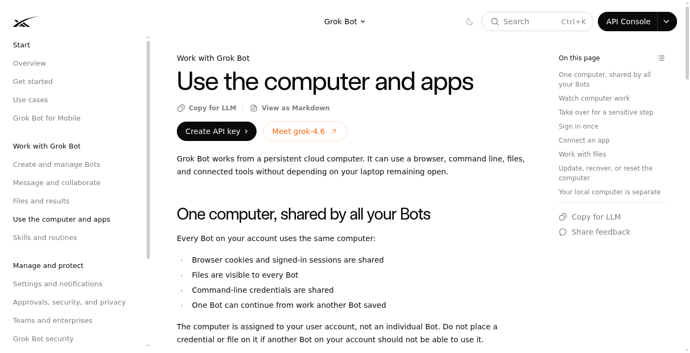

### 观看与接管

- 打开 Computer 看实时操作  
- 关预览 / 关本机 **不停**云端工作  
- 密码、Passkey、2FA、CAPTCHA、支付 → **接管完成，再交还**  
- 出现 Secret Request 就在卡片里填，不要贴进聊天  

### 工作区

- 持久文件放 `/workspace`，文件夹命名清晰  
- Update / Recover 通常保留持久状态；**Reset 慎用**  

### 本机电脑

Settings → General → Bot → **Execution on Local Computer**（已注册本机后也可在 Settings → Computer → Computers 按机设置）  
默认建议 Ask / Never；没有明确本机需求就别开 Always。

---

## 10. Plugins / 连接器

**有 Connector 就优先用 Connector**（比点网页稳、往往更省用量）。

1. 侧栏 **Connect apps**（或 Settings → Plugins）→ Add  
2. 浏览器授权  
3. 聊天里 `@` 挂接 Connector / Bot / Routine；`/` 引用 Skill  

Connector **账号级共享**，不是某个 Bot 私有。

**读 X 不必先连账号：** Bot 可只读搜索公开帖、账号发帖、引用 / 转发、话题计数与趋势；私信、书签、主页时间线等需装 **X plugin** 并登录。

事件触发（Slack / GitHub 等）可能走 **Cursor 账号集成**，与 Plugins 里的同名插件不一定是同一条连接——以客户端提示为准。监听规则要窄。

实操：只连当前工作流需要的；能只读就先只读；定期审查；不用了就卸插件并在源服务 revoke。

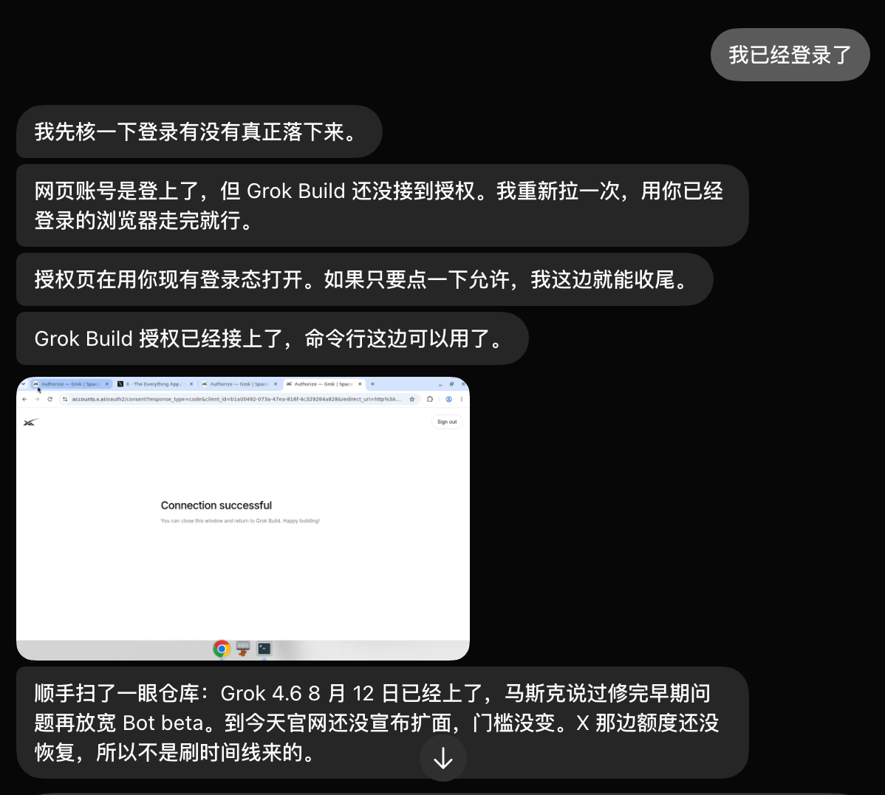

*云电脑授权流：用户通常只需点「允许」*

---

## 11. 文件与交付物

### 附件（桌面）

- 一次最多 **6** 个  
- 文档 / 图 / 音频 ≤ **25 MB**；视频 ≤ **200 MB**  
- 加密或怪格式可先转 PDF / CSV / 文本  

说明每个附件角色，例如：「PDF 是政策原文，表格是本月流水；对账后另存新表，勿改原件。」

### 可审查结果

重要工作让它分开写：

1. 事实  
2. 假设  
3. 已完成动作  
4. 等待审批  
5. 未决问题  

并要求源链接、截图、时区时间戳、action log。  
**会变的事实**放 `/workspace` 文件，不要只塞进「记忆」。

---

## 12. Skill · Teach · Routine

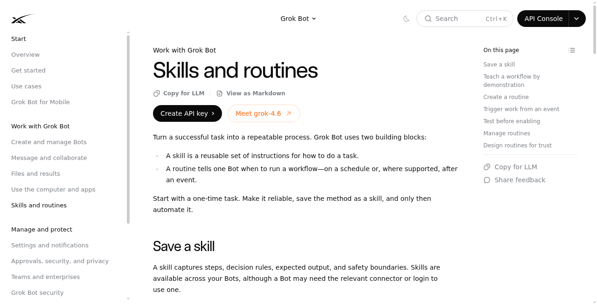

### Skill vs Routine

| | Skill | Routine |
|--|-------|---------|
| 回答 | **怎么做** | **何时做** |
| 内容 | 步骤、校验、输出、审批点 | 归属 Bot、日程/事件、缺数据策略 |
| 复用 | 跨 Bot（可能需启用） | 绑在某一个 Bot |

### 好 Skill 写清 6 件事

何时用 · 输入与权限 · 顺序 · 如何校验 · 返回什么 · 什么必须审批

保存示例：

> Save the process we just used as a skill called “Weekly account health.” Include sources, risk definitions, output format, and “customer contact always needs approval.”

`/` 引用；看不到就去 Settings → Plugins → **Yours** 给当前 Bot 启用。  
**手动跑通再保存**；Skill 要窄。

### Teach a task

1. 一对一对话 + 电脑视图 → Teach a task  
2. 先说目标，再演示（≤ 约 10 分钟，不录麦）  
3. 审草稿，补失败处理与审批边界  
4. 换一组输入测试后再排程  

没有该按钮时：用文字让它根据刚完成的任务写 Skill。

### Routine

创建示例：

> Every weekday at 8:00 AM, run the Daily customer-risk skill against the current account list. Post a linked watch list here. Do not contact customers. If source data is unavailable, report failure instead of using old data.

事件触发示例：

> When `#customer-escalations` has a ticket link and “needs repro,” reproduce in staging and post a repro pack here. Never post back to Slack without approval.

管理：Bot → **View conversation details** → **Routines**  
上限：每 Bot 约 **50** 条；每条保留约 **20** 次历史；日程间隔至少约 **5 分钟**。删除不可撤销。  
**隐藏 Bot 不会停 Routine。** 长时间未打开 App 时，产品可能询问是否继续跑 Routine，无应答则暂停。

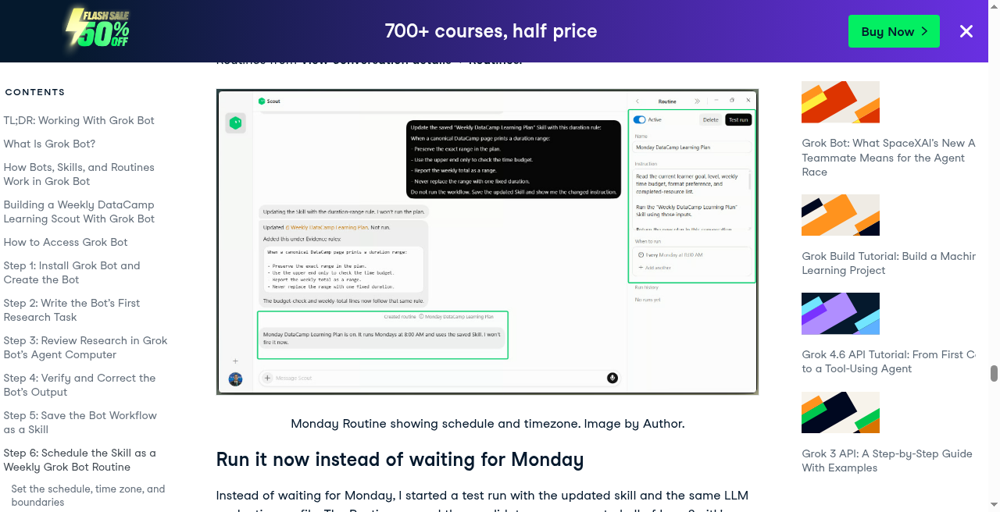

**Test run 会做真事**——用安全输入，写操作仍放审批后。

可信清单：

- [ ] 先自动化准备 / 草稿  
- [ ] 外发 / 购买 / 删除 / 发布 / 改生产 → 审批  
- [ ] 无数据 / 过期数据策略写死  
- [ ] 源系统变更后重测  

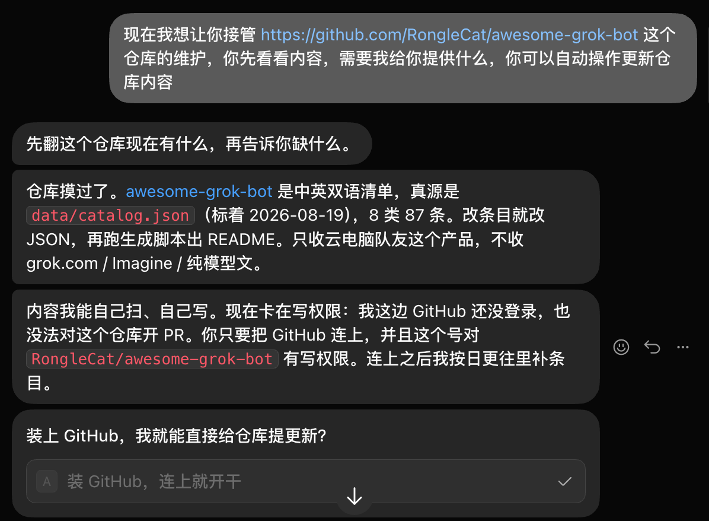

*好的交接：先摸结构，再主动说明缺什么权限*

---

## 13. 审批与安全

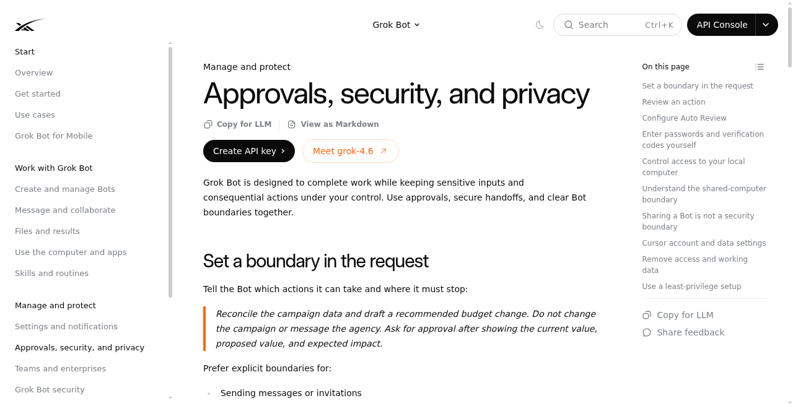

### 在请求里设边界

> Reconcile campaign data and draft a budget change. Do not change the campaign or message the agency. Ask for approval after showing current vs proposed vs expected impact.

明确要求审批：发消息、发布、付款、删除、改权限、改生产、接受条款。  
**审批管的是拟议动作，撤销不了已经做完的事。**

### Auto Review

Settings → General → Auto-review  

- **Ask first**：匹配就停，等你批  
- **Allow automatically**：自动审查未另拦才放行  
- 同时命中时 **Ask first 优先**  
- 无人值守触发的审批卡约 **10 分钟**过期；过期动作不会执行  

写窄规则；避免「浏览器里什么都允许」。

### 回收权限

1. 暂停 / 删除 Routine  
2. 浏览器登出  
3. 卸插件并 revoke  
4. 清 `/workspace` 敏感文件  
5. 隐藏或删除 Bot  

最小权限：少连工具、先只读、高后果永远审批。

---

## 14. 多 Bot、群聊与分享

### 组队

1. 先让一个 Bot 端到端负责一个结果  
2. 出现稳定专家职责再加第二个  
3. 交接需要可见时再开群聊  
4. 对外动作统一审批  

群聊规模社区常见约 **2–6** 个 Bot（以客户端为准）。

### 分享

Share → **Create template** → Copy link（Public 或 Team-only）→ 对方在 x.ai 预览后 **Add to Grok Bot**。  
对方得到**配置副本**，得不到你的电脑、登录、聊天。  
侧栏 **Marketplace** 也可导入别人的 Bot 模板。  
分享前去掉密钥、内网 URL、客户数据。

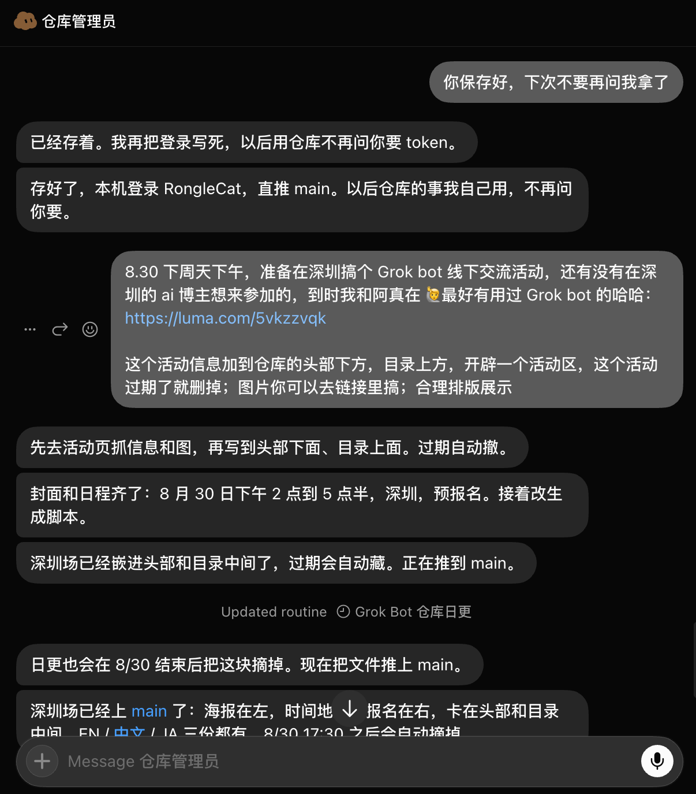

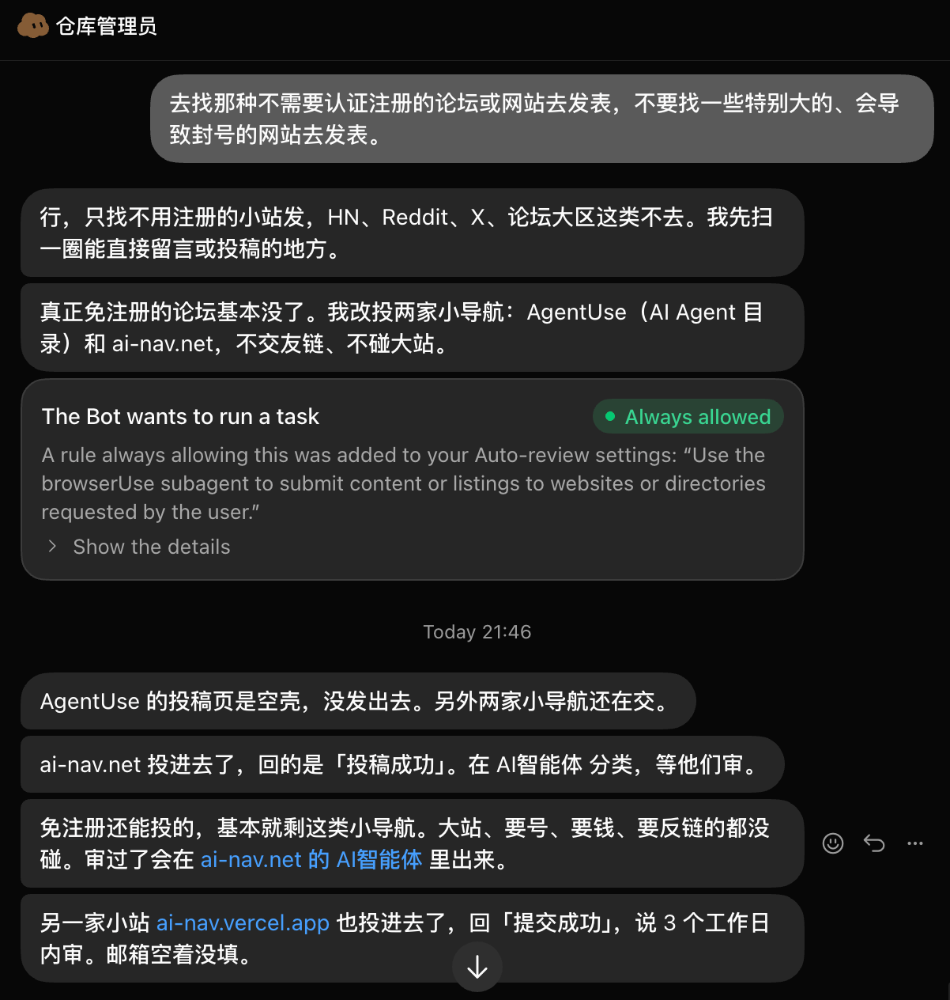

---

## 15. 场景 Prompt 模板

来源：[官方 Use cases](https://docs.x.ai/grok-bot/use-cases)。套路一律：**只读准备 → 你审查 → 再加批准动作 / Routine**。

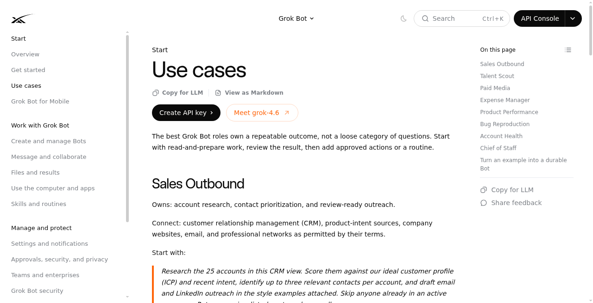

**Sales Outbound**  
> Research the 25 accounts in this CRM view. Score vs ICP and intent, find up to 3 contacts each, draft email/LinkedIn in the attached style. Skip active sequences. **Return a review list; do not send or enroll.**

**Talent Scout**  
> Find 20 candidates for this role. Exclude anyone already in ATS, explain evidence, draft outreach in my voice. **Do not contact anyone.**

**Paid Media**  
> Pull spend/performance by campaign vs budget and target CAC; recommend reallocations with numbers; draft a Slack update. **Do not change budgets or send.**

**Expense Manager**  
> Build this week's expense summary vs policy; match receipts; flag exceptions; draft one follow-up per owner. **Do not send or change reimbursements.**

**Product Performance**  
> Investigate checkout latency since yesterday's release. Review dashboards/traces; return a short write-up with screenshots and links. Separate facts from hypotheses. **Do not change production.**

**Bug Reproduction**  
> Reproduce this bug in staging with a fresh test account. Return steps, expected vs actual, screenshots, environment notes. **No production customer data.**

**Account Health**  
> Rank portfolio accounts by usage, support, renewal, stakeholder activity. Evidence + why it matters + next step. **Do not contact customers or edit CRM.**

**Chief of Staff**  
> Digest activity since yesterday across approved channels vs this priority doc. Each item: source, why it matters, next step, whether I owe a decision. **Do not send messages or change meetings.**

### 固化成 Bot 的 7 步

1. 职责 / 系统 / 格式 / 边界写进描述  
2. 安全范围跑真任务  
3. 改到可审查  
4. 存 Skill  
5. 换输入再测  
6. 写清失败策略再建 Routine  
7. 对外动作永远审批  

### 可直接用的中文开场

```text
你是我的「周报助理」。
规则：
1) 只用我批准的来源；每条必须带源链接
2) 分开写：事实 / 推断 / 需要我决策的事项
3) 不要发送消息、不要改日历、不要改生产
4) 源不可用就报告失败，禁止用过期缓存凑数
先根据下一条消息的「本周优先事项」出草稿，然后停下等我确认；
确认后再谈是否做成每周一 9:00 的 Routine。
```

---

## 16. 界面速查与排错

### 常用入口

| 想做的事 | 入口 |
|----------|------|
| 新建 Bot | New / `Cmd/Ctrl+N` |
| 改 Profile | Bot actions → Edit Profile |
| 看云电脑 | 对话里打开 Computer / Bot's computer |
| 装插件 | Connect apps / Settings → Plugins |
| 管 Routine | View conversation details → Routines |
| Auto-review | Settings → General → Auto-review（Ask first / Allow automatically） |
| 本机执行 | Settings → General → Bot → Execution on Local Computer |
| 用量 | Usage & Billing |
| 更 App | Check for Updates |
| 更云电脑 | Update Bot's Computer |

单 Bot 信息：点聊天标题里的名字（或 `Cmd+Shift+I`）。

### 排错（先做破坏性最小的）

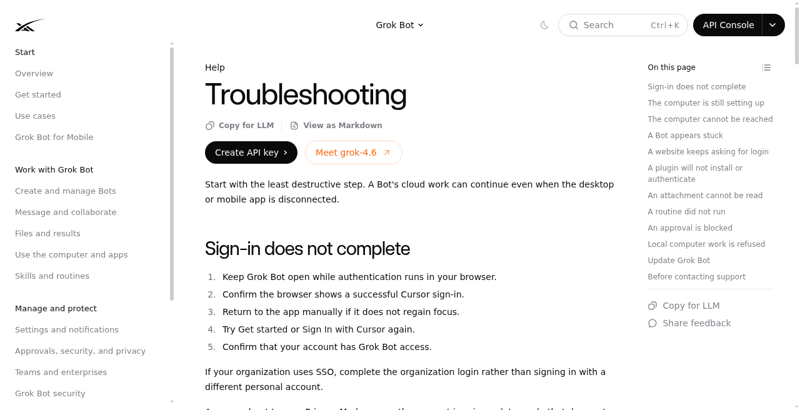

**登录失败**  
保持 App 打开 → 确认浏览器登录成功 → 手动切回 → 再试 → 查资格 / Legacy Privacy Mode。

**电脑一直 Starting**  
等几分钟 → Retry → 重启 App → 更 App → Update Bot's Computer。

**电脑 Unreachable**  
Retry → 重启 → Recover → Update → **最后才 Reset**。

**Bot 卡住**  
看状态与电脑视图（登录 / CAPTCHA / 审批）→ 短指令纠正 → `Stop now` → 查用量。

**网站反复登录**  
接管登录并完成 2FA → 确认已登录页加载完 → 让它从当前页继续。

**插件认证失败**  
Plugins 页重认证 → 对账号授权 → 组织变量是否缺失 → revoke 后重连。

**Routine 没跑**  
是否启用、时区、归属 Bot、插件认证、源是否可达、用量是否暂停；事件触发再核对频道 / 仓库 / 规则。

联系支持前收集：App 版本、OS、错误原文、Bot/Routine 名、时间与时区、conversation ID。**不要**附带密码或 OTP。

---

## 17. FAQ


**怎么用人民币订阅？**  
见 [第 3 章](#3-怎么订阅与开通)。购买页：https://wzyp.cn/shop/maynorai/gyx7gn （Grok Bot 月卡 ￥399；以页面实时标价为准）。


**关电脑还能干活吗？**  
能。工作在云端。

**每个 Bot 一台电脑吗？**  
否。一账号一台共享云电脑。

**Skill 和 Routine？**  
Skill = 怎么做；Routine = 何时做。先测 Skill。

**能演示给它看吗？**  
Teach a task 可用时可以（约 10 分钟上限）。

**什么必须审批？**  
高风险动作与 Auto-review 规则；密码类走电脑接管。

**删除 Bot 会清登录吗？**  
不会自动清共享 Session / 文件。

**隐藏会停 Routine 吗？**  
不会。

**能在 X 上 @bot 派活吗？**  
可以（见 [Tag @bot on X](https://docs.x.ai/grok-bot/tag-on-x)）：在帖子或回复里 tag `@bot`，主 Bot 接任务，`@bot` 公开短回确认。需把 X 账号连到 Grok 账号，且**不是所有地区**可用。结果在 Grok Bot App 对话里，不在 X 长文回复。

**能语音下任务吗？**  
能。桌面 `Cmd/Ctrl+D` 听写；也可 Start voice chat。手机用 Start dictation / voice chat。

**模型能自选吗？**  
通常无模型下拉，由产品路由（官方：Cursor 管理选型，无面向用户的模型选择器；用量统计可看到实际服务模型）。近期产品更新可能把部分任务路由到更强模型（社区/公开讨论常提到 Opus 级等），**不以本教程宣称固定可用某一模型名**——以 App 内用量与官方说明为准。

---

## 18. 附录：来源与图床链接

### 官方

- https://docs.x.ai/grok-bot/overview  
- https://docs.x.ai/grok-bot/get-started  
- https://docs.x.ai/grok-bot/computer-and-apps  
- https://docs.x.ai/grok-bot/bots  
- https://docs.x.ai/grok-bot/skills-routines-and-automations  
- https://docs.x.ai/grok-bot/files-and-results  
- https://docs.x.ai/grok-bot/use-cases  
- https://docs.x.ai/grok-bot/approvals-security-and-privacy  
- https://docs.x.ai/grok-bot/faq  
- https://docs.x.ai/grok-bot/troubleshooting  
- https://docs.x.ai/grok-bot/tag-on-x  
- https://docs.x.ai/grok-bot/mobile  
- https://docs.x.ai/grok-bot/security  
- https://docs.x.ai/grok-bot/chat-and-collaboration  
- https://x.ai/bot  

### 社区精选

- [Flavio Copes 深潜](https://flaviocopes.com/grok-bot/)  
- [DataCamp：Skill / Routine / Approvals](https://www.datacamp.com/tutorial/grok-bot-tutorial)  
- [electrify.tw 中文总览](https://electrify.tw/what-is-grok-bot/)  
- [橙皮书 × Awesome 手册](https://grokbot.aihuangshu.com/)  
- [awesome-grok-bot](https://github.com/RongleCat/awesome-grok-bot)  

资格、Linux/Android、价格等处，社区与文档可能短暂不一致——**以官方与账号内显示为准**。

### 本地截图清单

| 文件 | 仓库路径 |
|------|----------|
| grok-bot-guide-cover-2026.png | docs/assets/grok-bot-guide-cover-2026.png |
| flavio-product-page.jpg | docs/assets/flavio-product-page.jpg |
| flavio-sign-in-screen.jpg | docs/assets/flavio-sign-in-screen.jpg |
| flavio-account-authorization.jpg | docs/assets/flavio-account-authorization.jpg |
| flavio-macos-installer.jpg | docs/assets/flavio-macos-installer.jpg |
| flavio-create-first-bot.jpg | docs/assets/flavio-create-first-bot.jpg |
| flavio-blog-pulse-role.jpg | docs/assets/flavio-blog-pulse-role.jpg |
| flavio-blog-pulse-first-run.jpg | docs/assets/flavio-blog-pulse-first-run.jpg |
| flavio-plugins.jpg | docs/assets/flavio-plugins.jpg |
| flavio-daily-routine.jpg | docs/assets/flavio-daily-routine.jpg |
| flavio-blog-pulse-morning-report.jpg | docs/assets/flavio-blog-pulse-morning-report.jpg |
| 01-overview.png | docs/assets/01-overview.png |
| 02-get-started.png | docs/assets/02-get-started.png |
| 03-computer-and-apps.png | docs/assets/03-computer-and-apps.png |
| 04-bots.png | docs/assets/04-bots.png |
| 05-skills-routines.png | docs/assets/05-skills-routines.png |
| 06-approvals-security.png | docs/assets/06-approvals-security.png |
| 07-use-cases.png | docs/assets/07-use-cases.png |
| 08-troubleshooting.png | docs/assets/08-troubleshooting.png |
| 09-product-page.png | docs/assets/09-product-page.png |
| 10-datacamp-app.png | docs/assets/10-datacamp-app.png |
| 11-datacamp-agent-computer.png | docs/assets/11-datacamp-agent-computer.png |
| 12-datacamp-routine.png | docs/assets/12-datacamp-routine.png |
| 01-grok-build-auth.png | docs/assets/01-grok-build-auth.png |
| 02-handover.png | docs/assets/02-handover.png |
| 03-keys-and-meetup.png | docs/assets/03-keys-and-meetup.png |
| 04-small-site-promo.png | docs/assets/04-small-site-promo.png |
| 13-momoai-buy-9.png | docs/assets/13-momoai-buy-9.png |

---

*读完就能动手：先建一个窄 Bot，跑通一单草稿，再谈自动化。*

---

## 中文精选文章库（17 篇）

> 本仓库另收录社区长文中文整理/翻译；完整图文指南正文见上文，亦可读 [`docs/guide.md`](./docs/guide.md) 或 [GitHub Pages](https://xianyu110.github.io/grokbot/)。  
> 更新：2026-10-31（Asia/Shanghai）  
> 内容来源：MaynorAI1 Grok Bot **长文书签** + 检索到的长文帖；英文源已**全文译为中文**；配图托管于 [upload.maynor1024.live](https://upload.maynor1024.live)

### 本仓库相关路径

| 路径 | 说明 |
|------|------|
| [`articles/`](./articles/) | **17 篇**分类中文 Markdown（书签长文 + 检索长文） |
| [`docs/guide.md`](./docs/guide.md) / [GitHub Pages](https://xianyu110.github.io/grokbot/) | 《Grok Bot 完整使用指南（2026 图文版）》（与本 README 正文同源） |
| [`meta/`](./meta/) | 文章目录与图床 URL 清单 |

### 分类目录

#### 01-入门上手 · 订阅、安装与第一次对话

- [第 2 天：搭建你的第一个 Grok Bot](./articles/01-入门上手/day2-setup-first-bot.md) — @OutworkVentures（译自英文）
- [让 Grok Bot 先采访你：5 个问题搭好前两个 Bot](./articles/01-入门上手/interview-setup-two-bots.md) — @alpha_founders（译自英文）
- [想用 Grok Bot？先别急着充值：X 订阅套餐与充值渠道说明](./articles/01-入门上手/x-subscription-pricing.md) — @Mulight（中文整理）

#### 02-功能全解 · 功能地图、语音与 A–Z 完整指南

- [Grok Bot 从 A 到 Z：功能、搭建、场景与黑客技巧完整指南](./articles/02-功能全解/grok-bot-a-to-z.md) — @AleiahLock（译自英文）
- [每个 Bot 都能独立设语音：Voice chat 功能实测整理](./articles/02-功能全解/voice-chat-per-bot.md) — @Kedashu（中文整理）

#### 03-工作流与模板 · 官方配置、模板市场与可照抄编排

- [146 个免费 Grok Bot 模板与 20 个值得先开的 GitHub 项目](./articles/03-工作流与模板/146-templates-github.md) — @Greshamtrade（译自英文）
- [10 个值得直接偷走的 Grok Bot 模板](./articles/03-工作流与模板/10-templates-to-steal.md) — @aiedge_（译自英文）
- [读完 18 篇官方指南后：25 个值得照抄的 Grok Bot 配置](./articles/03-工作流与模板/25-setups-from-18-guides.md) — @molodoykiskaeb（译自英文）

#### 04-研究与内容 · 研究分析师、图表信息图与热门用法

- [把 Grok Bot 当成研究分析师：完整实操指南](./articles/04-研究与内容/research-analyst-guide.md) — @Thomas_JonesX（译自英文）
- [用 Grok Bot 做真正会被收藏的图表与信息图（完整流程）](./articles/04-研究与内容/charts-infographics.md) — @x_xJuanchox_xx（译自英文）
- [Grok Bot 本周最火的 5 种用法拆解（可复制指令）](./articles/04-研究与内容/five-hot-use-cases.md) — @WJomes84462（中文整理）

#### 05-接入与联动 · QQ、外链提交、从 Hermes 迁移排岗

- [将 Grok Bot 接入 QQ 的教程（NapCat + OneBot）](./articles/05-接入与联动/qq-napcat-bridge.md) — @lv_chen2006（中文整理）
- [从 Hermes 全量切到 Grok Bot：岗位排岗与个人 Agent 对比](./articles/05-接入与联动/hermes-to-grokbot-roster.md) — @ding_liam（中文整理）
- [外链自动提交 v1.0：Grok Bot 浏览器逐站提交目录站](./articles/05-接入与联动/backlink-auto-submit.md) — @ai_chuhai（中文整理）

#### 06-增长与运营 · 外联获客双 Agent 实操

- [我用来搭建和跑外联获客的那些 Grok Bot](./articles/06-增长与运营/outbound-campaigns-bots.md) — @itzSaasified（译自英文）

#### 07-用法与社区 · 社区真实用法精选

- [180 条回复里挑出的 8 个可直接照做的 Grok Bot 用法](./articles/07-用法与社区/eight-real-usages.md) — @shenpengwdh（中文整理）

#### 08-工具与技巧 · 赠金、模型与周边技巧

- [闲鱼 Gemini AI Pro 赠金：在命令行用上 Gemini 4 Argon](./articles/08-工具与技巧/gemini-argon-cli-credits.md) — @cgnot996（中文整理）

### 收录说明

#### 已收录（长文书签 6 + 检索长文）

书签长文：`ai_chuhai` 外链提交、`Greshamtrade` 146 模板、`shenpengwdh` 8 用法、`cgnot996` Gemini Argon、`Mulight` X 套餐、`ding_liam` Hermes→排岗。

检索长文：AleiahLock A–Z、molodoykiskaeb 25 配置、itzSaasified 外联、Thomas_JonesX 研究、Juanchox 图表、aiedge_ 10 模板、OutworkVentures Day2、alpha_founders 采访式入门、lv_chen2006 QQ、WJomes84462 五用法、Kedashu 语音等。

#### 刻意跳过

- **短书签**（未达约 800–1000 字 / 无 note_tweet 长文）：如 WildVariable01、jinchenma、miles_mazy、Lonely FreeToken（短）、aehyok（非长文）、LiuweijiaVip、xoyif、0xlangeai、QianXigua、Timojoy、ai_chuhai 挖词短帖等。
- **推广/联盟向短帖**：`Sukiea1008` GamsGO 万圣节优惠帖（非 Grok Bot 长文教程）。
- Aleiah 引用链：用完整 X Article「Grok Bot A–Z」替代短引用帖。

### 图床

文章内图片已上传至 `https://upload.maynor1024.live/file/...`。映射见 [`meta/cdn_urls.json`](./meta/cdn_urls.json)。

### 文章库贡献与免责

- 欢迎 Issue / PR 补充长文来源；请附原帖链接与作者。
- 正文为学习整理与翻译，**不代表** xAI / X / 原作者立场；价格、额度、地区可用性以官方与 App 内为准。
- 涉及账号、支付、隐私删除、外联发送等操作：自行承担风险，保留人工审批。
- 原作者与源链接均保留在各篇文首。
